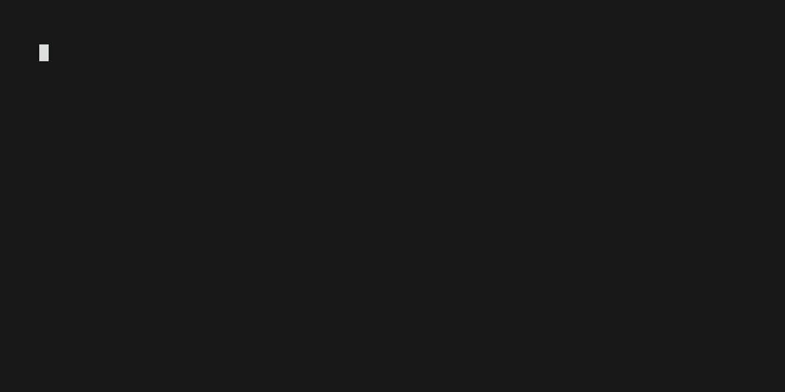
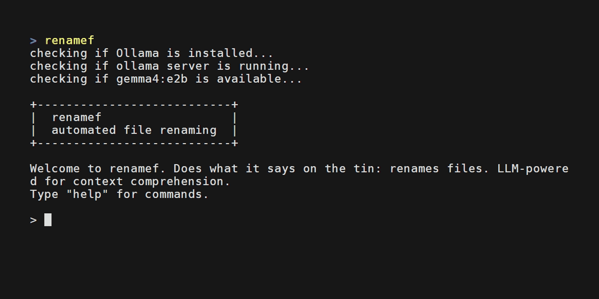

# Renamef
A privacy-oriented app that renames or summarizes documents using a local LLM.\
(name pronounced in a Shakespearean manner with an English accent, followed by a snobbish twitch of an eyebrow)

## Features
  
 

Renamef's greatest strength is privacy: no data leaves your local machine and you can automate the renaming of (theoretically) as many files as you want.
You can use features like `listf` or `summf` to list files in a directory or give you a summary of a given file. `renamef` is the meat of the app and allows you to rename all files in a directory (or its subdirectories) in an automated context-aware manner.

## Requirements
#### Recommended System Specs
- **OS:** Linux, Windows or Mac
- **Memory:** 6GB VRAM (normal PC) or 16GB unified system memory (Mac)
- **Disk Space:** 10GB (PC) or 13GB (Mac) — Ollama installation + model takes majority of the space

#### Other
- Renamef requires Python installed on your machine.  
- Renamef will check if you have Ollama installed, if not, it will attempt to install it for you and subsequently pull the relevant model from Ollama to your machine.

## Installation
Install Python 3.12 or newer (on Windows, adding it to PATH during setup). Then, open a terminal and...

#### Windows 
1. Install pipx: `python -m pip install --user pipx`
2. Add pipx to your PATH: `python -m pipx ensurepath`
3. Restart terminal
4. Install Renamef: `pipx install renamef`

#### Mac
1. Install Homebrew: `/bin/bash -c "$(curl -fsSL https://raw.githubusercontent.com/Homebrew/install/HEAD/install.sh)"` (then run the commands it shows under 'Next steps')
2. Install pipx: `brew install pipx`
3. Add pipx to your PATH: `pipx ensurepath`
4. Restart terminal
5. Install Renamef: `pipx install renamef`

#### Linux
1. Install pipx: `sudo apt install pipx` (or whatever package manager you use)
2. Add pipx to your PATH: `pipx ensurepath`
3. Restart terminal
4. Install Renamef: `pipx install renamef`

## Usage
1. Open terminal
2. Type `renamef` to launch the app
3. Type `help` for a list of commands
4. Type `<command> -h` for command-specific guidance and more examples

Example: `summf --thinking "C:\Users\Public\Documents\2026-03-14_product-spec_chronodyne.pdf"`
 

## Configuration (WIP)
The following things can be configured in `renamef`:
- LLM used
- Supported languages (by default they are English, German and Finnish)
- Location of the tessdata folder

You can do any of the above by editing the `renamef/config.toml` file in the project's package folder with a text editor of your choice. Currently, the `config.toml` is buried deep within the user folder. To find it, run the following command on any platform:  
`pipx runpip renamef show renamef`. The "Location" line shows the path to the project's package folder, where you can find the `renamef` directory. An additional limitation is that the file resets whenever you choose to update the app.

#### Changing the model
The underlying LLM can be changed simply by changing the model's name to one you wish to use. You can find a list of local models from the [Ollama website](https://ollama.com/search?c=local). Note that larger models will require more VRAM or system memory than the default model.

#### Expanding language support
1. Download additional languages from [tesseract-ocr/tessdata](https://github.com/tesseract-ocr/tessdata)
2. Copy them to the **tessdata** folder in this project's package folder.
3. Add the additional language(s) to the `renamef/config.toml` file's "languages" variable under **\[ocr]**.

For example, to support Swedish you would download the **swe.traineddata** from Tesseract, move it to the `renamef/tessdata` folder, and finally, add it to the `renamef/config.toml` file like so: `languages = 'eng+deu+fin+swe'`, and you are good to go!

#### Changing tessdata folder path
In `renamef/config.toml` change the `tessdata = 'default'` entry to an absolute path of your choice, e.g. `tessdata = 'C:\Users\Public\Documents\tessdata'`

## Limitations
- Renamef only supports the following file types: pdf, txt, md, png, jpeg, jpg, webp, gif
- By default, Renamef uses a small 2 billion parameter local model (Gemma 4 e2b). Model accuracy varied in tests, but was still useful. Results improved with thinking mode on.
- Non-ASCII characters (öäå) in paths or file names are not currently supported. Note that their presence inside documents is not an issue.
- By default, Renamef can read documents in three languages: English, German and Finnish.

## License
This project is licensed under the GNU AGPL-3.0 or later — see [LICENSE](LICENSE).

It depends on PyMuPDF and pymupdf4llm by Artifex Software, licensed under AGPL-3.0.
Bundled Tesseract language data (renamef/tessdata/) is licensed under Apache 2.0 — see renamef/tessdata/LICENSE.
The LLM (Gemma 4) is downloaded via Ollama and is subject to its own license.
